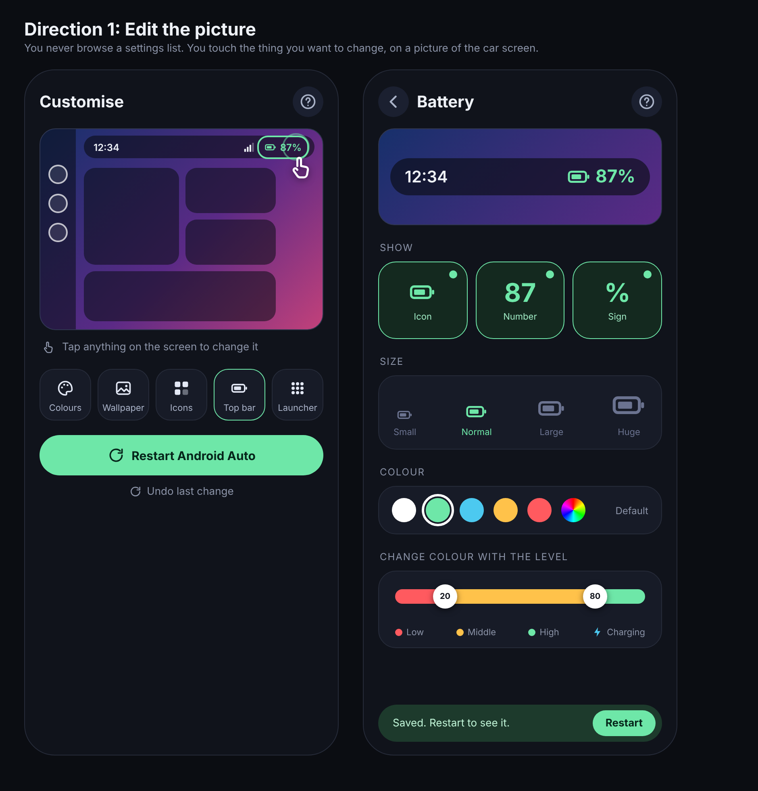
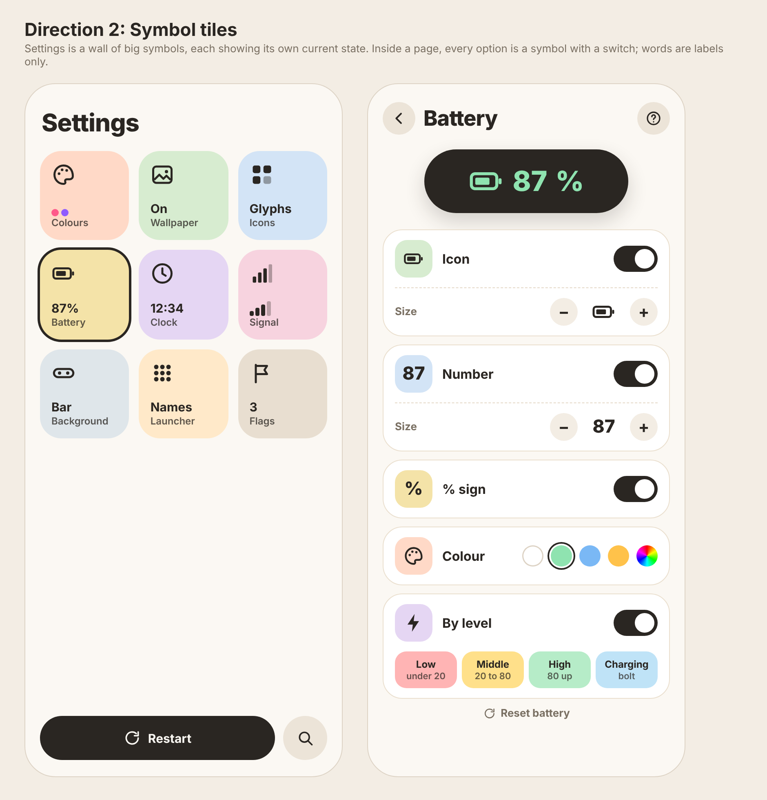
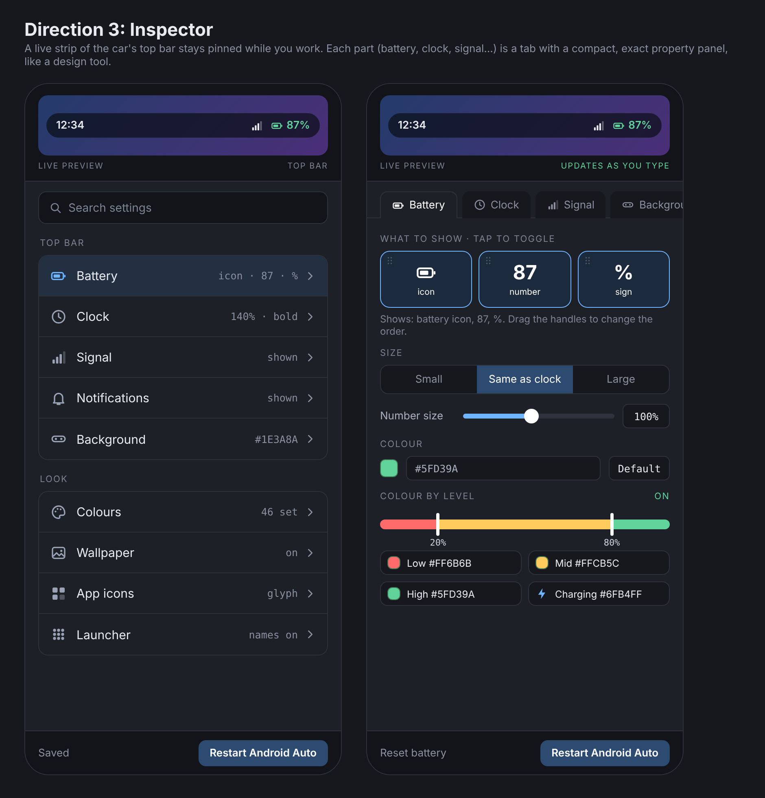

# Settings design options

Three entirely different directions for the settings side of the phone app, each drawn on the
same two screens: the **Settings entry point** and the **Battery page** (icon on/off, number
on/off, % sign on/off, size, colour, colour by level). Original artwork only: every symbol is
a plain SVG drawn for this folder, and the text uses the phone's own system font.

Pick one, mix parts, or ask for another round.

## 1. Edit the picture

- **Idea:** no settings list. Settings is a picture of the car screen; you tap the thing you want to change (the battery in the top bar) and a page for just that opens, with big symbol buttons for icon, number and %.
- **Good:** the fastest to understand, and the preview is always the thing you are changing. Colour by level is a draggable bar.
- **Trade-off:** hardest to build (a drawn car screen with tappable parts) and things that are not visible on the car screen (updates, backup) still need an ordinary list.

## 2. Symbol tiles

- **Idea:** Settings is a wall of big coloured tiles, each showing its own current state (87%, 12:34, signal bars). Inside a page every option is a symbol with a switch and a small stepper.
- **Good:** friendliest and easiest to scan; almost no reading; a tile never needs a paragraph.
- **Trade-off:** each tile shows only a tiny preview, and exact values (hex colours, exact percentages) are hidden behind steppers and swatches.

## 3. Inspector

- **Idea:** a live strip of the car's top bar is pinned at the top of every page. Settings is a compact list with each row's current value; the Battery page has tabs for the other bar parts, tokens for icon, number and sign, and exact fields.
- **Good:** most precise and the most room for plenty of settings; you can see the result while you edit anything.
- **Trade-off:** denser and more technical, so least inviting for a first-time user.

## Rebuild the pictures

The sources are in `src/`. With Node and Playwright installed, run `node render.js` here.
