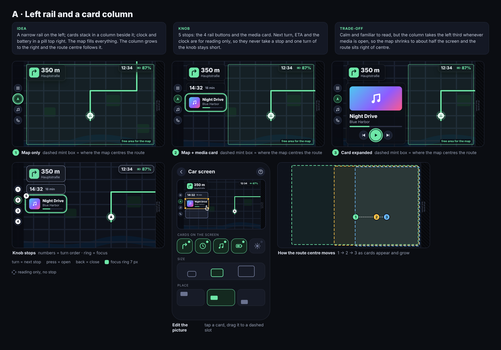
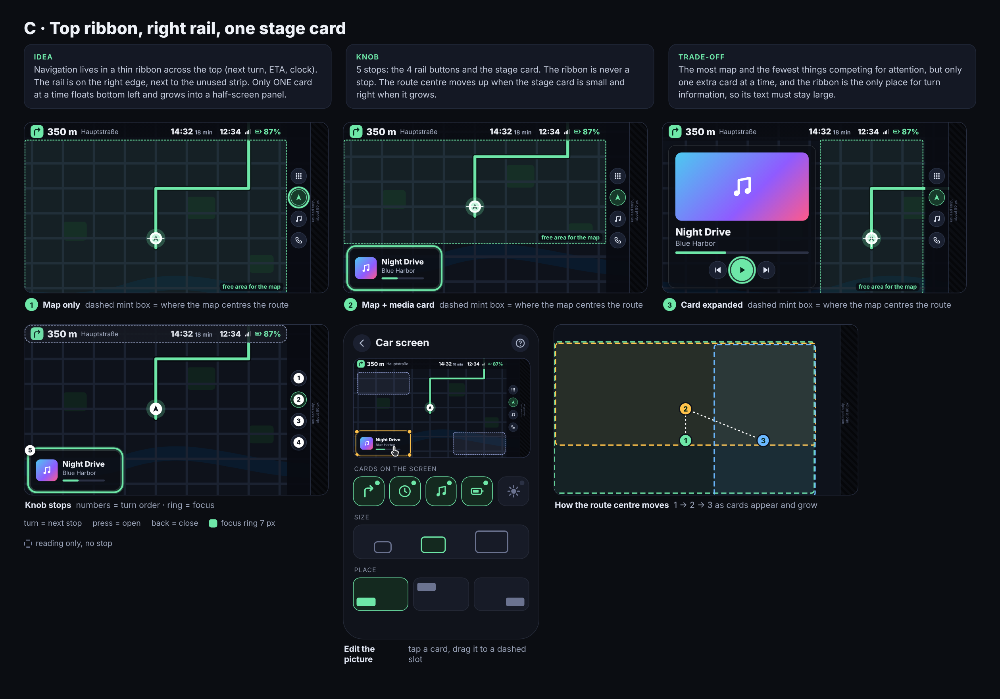

# Car screen layouts for MyPlay (three directions)

Drawn for the owner's car: 7-inch, **non-touch**, rotary knob only (turn, press, back), 1280x720 video of which about 1200x720 is visible (the hatched strip on the right is the roughly 80 px that is probably unused; unconfirmed), 213 dpi. Dark only. The map is the full-screen background; cards float on top; nothing is taken from Google's shapes, colours or icons. Everything is original artwork (plain shapes and symbols drawn for this folder, the phone's system font, a generic made-up street map).

Every picture shows the same three states, the knob stops, how the owner edits the layout in the "Edit the picture" way, and how the **free area** (dashed box, where the map app should centre the route) moves as cards appear and grow. The route marker sits in the middle of that box, a little below its centre line, so the map recentres into whatever space is left: it leans left when only the left is free, and slides the other way when a card grows.

Sizes used, so the worker can check readability at 213 dpi: next-turn distance 50 px, street and secondary text 25 to 27 px, ETA 40 px, buttons 68 px, focus ring 7 px mint with a soft glow.

## A. Left rail and a card column

- **Idea:** a narrow rail on the left, cards stacked in a column beside it, clock and battery in a pill top right. The column grows to the right and the route centre follows it.
- **Knob:** 5 stops (4 rail buttons and the media card). Next turn, ETA and clock are for reading only.
- **Trade-off:** calm and familiar, but the column takes the left third whenever media is open, so the map shrinks to about half the screen.

## B. Bottom dock, cards float at the corners

- **Idea:** a low dock of big symbols along the bottom with clock and battery on its right; next turn top left; media pops up bottom right and becomes a tall card on the right, so the route slides left.
- **Knob:** 6 stops (5 dock buttons in a fixed place along the bottom edge, and the media card).
- **Trade-off:** keeps the map widest, which suits a wide screen, but the dock costs 92 px of height all the time and the media card is far from the dock buttons.

## C. Top ribbon, right rail, one stage card

- **Idea:** navigation in a thin ribbon across the top (next turn, ETA, clock); the rail on the right edge beside the unused strip; only one card at a time floats bottom left and grows into a half-screen panel.
- **Knob:** 5 stops (4 rail buttons and the stage card). The ribbon is never a stop.
- **Trade-off:** the most map and the least competing for attention, but only one extra card at a time, and the ribbon is the only place for turn information, so its text must stay large.

## Notes and open questions

- Whether the rail sits left or right matters because of the unused strip: C puts it against that strip, A and B keep everything inside the visible 1200 px. This is unconfirmed on the car.
- The knob's tilt is not yet known; these layouts need only turn, press and back. If tilt exists it could move focus between the rail and the cards in one step.
- "Edit the picture" for the car screen: the phone shows the car-screen picture, you tap a card (amber outline), drag it to one of the dashed slots, then pick its size and which cards are on. Slots are fixed per layout so the map never loses a clear free area.
- Only pictures were made; nothing in MyPlay was changed. I worked from the written brief and did not read the MyPlay repository (it is outside what this session is set up to read), so the card list (next turn, ETA, media, clock and status) and the sizes should be checked against `docs/plans/myplay.md` and the screenshots there.

To redraw: `node render.js` in this folder (needs Node and Playwright); sources are in `src/`.
