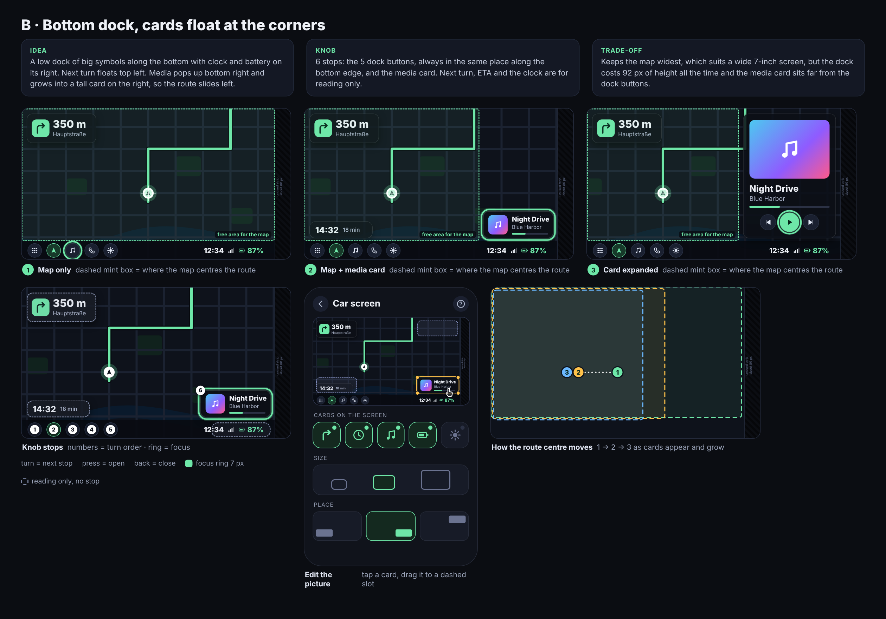
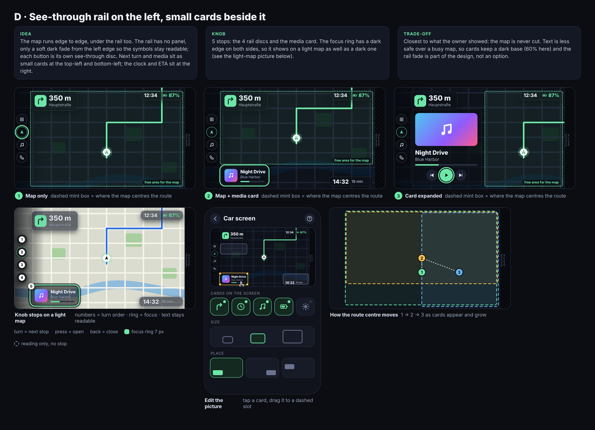
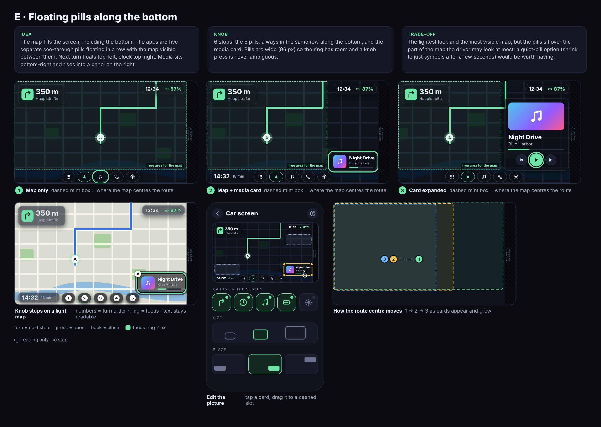
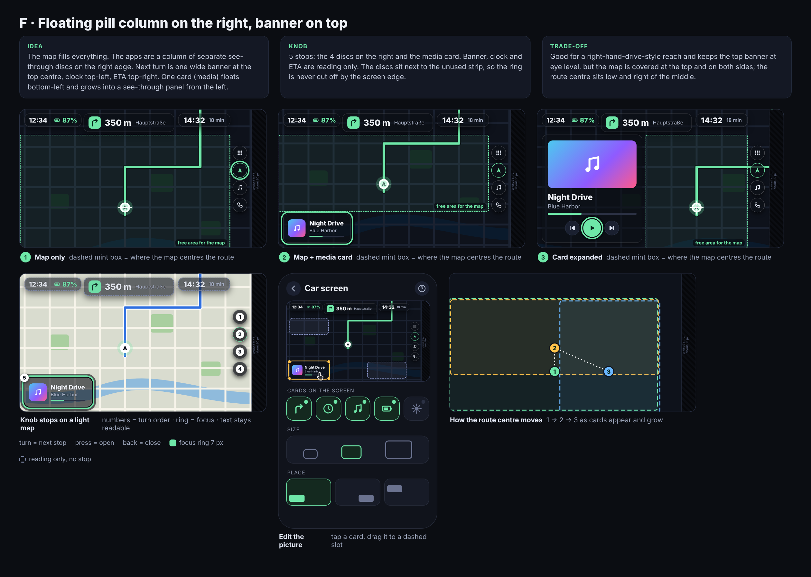
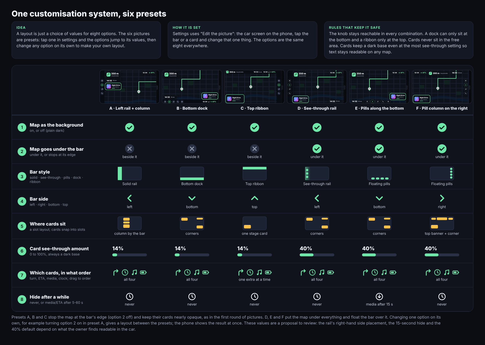
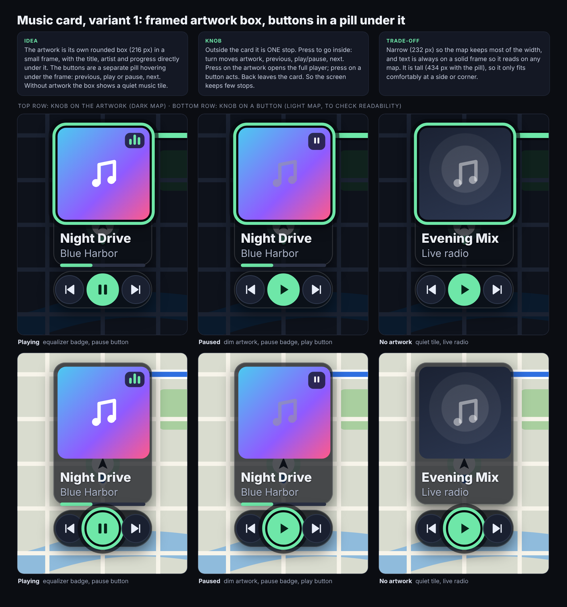
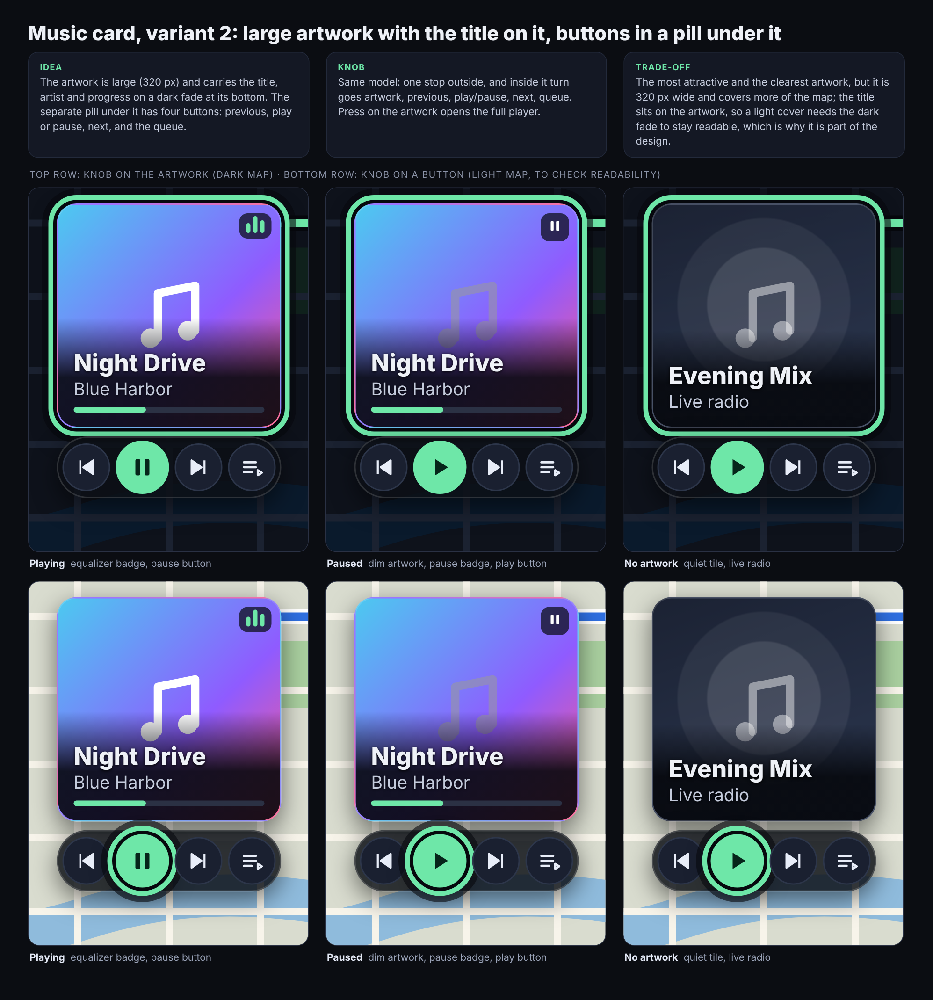
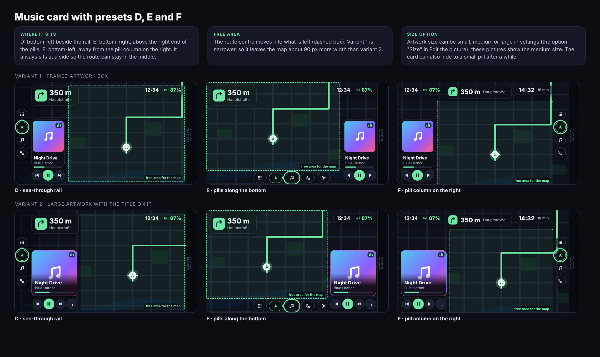

# Car screen layouts for MyPlay (six presets and one customisation system)

Layouts A, B and C stop the map at the edge of the bar. Layouts D, E and F (second round, after the owner's feedback) let the map fill the whole visible screen, **under the bar and apps too**, with everything floating over it. The last section turns all six into one set of options.

Drawn for the owner's car: 7-inch, **non-touch**, rotary knob only (turn, press, back), 1280x720 video of which about 1200x720 is visible (the hatched strip on the right is the roughly 80 px that is probably unused; unconfirmed), 213 dpi. Dark only. The map is the full-screen background; cards float on top; nothing is taken from Google's shapes, colours or icons. Everything is original artwork (plain shapes and symbols drawn for this folder, the phone's system font, a generic made-up street map).

Every picture shows the same three states, the knob stops, how the owner edits the layout in the "Edit the picture" way, and how the **free area** (dashed box, where the map app should centre the route) moves as cards appear and grow. The route marker sits in the middle of that box, a little below its centre line, so the map recentres into whatever space is left: it leans left when only the left is free, and slides the other way when a card grows.

Sizes used, so the worker can check readability at 213 dpi: next-turn distance 50 px, street and secondary text 25 to 27 px, ETA 40 px, buttons 68 px, focus ring 7 px mint with a soft glow.

## A. Left rail and a card column

- **Idea:** a narrow rail on the left, cards stacked in a column beside it, clock and battery in a pill top right. The column grows to the right and the route centre follows it.
- **Knob:** 5 stops (4 rail buttons and the media card). Next turn, ETA and clock are for reading only.
- **Trade-off:** calm and familiar, but the column takes the left third whenever media is open, so the map shrinks to about half the screen.

## B. Bottom dock, cards float at the corners

- **Idea:** a low dock of big symbols along the bottom with clock and battery on its right; next turn top left; media pops up bottom right and becomes a tall card on the right, so the route slides left.
- **Knob:** 6 stops (5 dock buttons in a fixed place along the bottom edge, and the media card).
- **Trade-off:** keeps the map widest, which suits a wide screen, but the dock costs 92 px of height all the time and the media card is far from the dock buttons.

## C. Top ribbon, right rail, one stage card

- **Idea:** navigation in a thin ribbon across the top (next turn, ETA, clock); the rail on the right edge beside the unused strip; only one card at a time floats bottom left and grows into a half-screen panel.
- **Knob:** 5 stops (4 rail buttons and the stage card). The ribbon is never a stop.
- **Trade-off:** the most map and the least competing for attention, but only one extra card at a time, and the ribbon is the only place for turn information, so its text must stay large.

## D. See-through rail on the left, small cards beside it (map under the rail)

- **Idea:** map edge to edge; the rail has no panel, only a dark fade from the left edge, and each button is its own see-through disc. Small cards at the top-left and bottom-left; clock and ETA on the right.
- **Knob:** 5 stops (4 discs and the media card). The focus ring has a dark edge on both sides so it shows on a light map as well as a dark one (see the light-map picture).
- **Trade-off:** closest to what the owner showed and the map is never cut, but text is less safe on a busy map, so cards keep a dark base (60% here) and the rail fade is part of the design.

## E. Floating pills along the bottom (map under the bottom)

- **Idea:** five separate see-through pills in a row along the bottom with the map visible between and under them; next turn top-left, clock top-right, media bottom-right rising into a panel.
- **Knob:** 6 stops (5 pills in a fixed row and the media card). Pills are 96 px wide so the ring has room.
- **Trade-off:** the lightest look and the most visible map, but the pills cover the part of the map the driver may look at most; a quiet-pill option (shrink to symbols after a few seconds) would help.

## F. Floating pill column on the right, banner on top (map under the edge)

- **Idea:** a column of separate see-through discs on the right edge, one wide next-turn banner at the top centre, clock top-left, ETA top-right; one media card bottom-left growing into a see-through panel.
- **Knob:** 5 stops (4 discs and the media card); the discs sit by the unused strip so the ring is never cut by the screen edge.
- **Trade-off:** keeps the banner at eye level, but the map is covered at the top and on both sides and the route centre sits low and right of the middle.

## One customisation system

Eight options, the same in settings for every layout, set in the "Edit the picture" way: **1** map as background, **2** map under the bar, **3** bar style (solid rail, see-through rail, floating pills, bottom dock, top ribbon), **4** bar side, **5** where cards sit, **6** card see-through amount, **7** which cards and their order, **8** hide after a while. The table shows the values that give each of the six pictures; choosing a preset sets all eight at once and any single option can then be changed on its own.

Rules: a dock only sits at the bottom, a ribbon only at the top, cards never sit in the free area, and cards keep a dark base even at the most see-through setting so text stays readable over any map colour. The default amounts (14% on A to C, 40% on D to F) and the 15-second hide in E are proposals; they depend on what the owner finds readable in the car.

## Music card over the map: artwork box with a separate button pill

The owner's idea: the artwork is its own box, sized sensibly, and below it a separate hovering menu of buttons. Two variants, each drawn playing, paused and with no artwork, with the knob on the artwork and on a button (the bottom row is on a light map to check that text and the focus ring stay readable).

### Variant 1: framed artwork box, three buttons

- **Idea:** a 216 px rounded artwork box in a small frame with title, artist and progress directly under it; a separate pill under the frame holds previous, play or pause, next.
- **Knob:** the whole card is one stop; press to go inside, then turn goes artwork, previous, play/pause, next; press on the artwork opens the full player; Back leaves.
- **Trade-off:** narrow (232 px) and always on a solid frame so it reads on any map, but tall (434 px with the pill) so it fits at a side or corner.

### Variant 2: large artwork with the title on it, four buttons

- **Idea:** a 320 px artwork with title, artist and progress on a dark fade at its bottom; a separate pill under it with previous, play or pause, next and the queue.
- **Knob:** same model, with the queue as a fourth inside stop.
- **Trade-off:** the most attractive, but 90 px wider and the title sits on the artwork, so the dark fade is part of the design.

### How they sit with presets D, E and F

D: bottom-left beside the rail. E: bottom-right above the right end of the pills. F: bottom-left, away from the pill column. The dashed box shows how the free area for the map shrinks. Artwork size (small, medium, large) would be a setting in "Edit the picture"; these pictures show medium. States: playing has an equalizer badge and a pause button; paused dims the artwork, shows a pause badge and a play button; no artwork shows a quiet music tile (live radio shows no progress bar).

## Notes and open questions

- Whether the rail sits left or right matters because of the unused strip: C puts it against that strip, A and B keep everything inside the visible 1200 px. This is unconfirmed on the car.
- The knob's tilt is not yet known; these layouts need only turn, press and back. If tilt exists it could move focus between the rail and the cards in one step.
- "Edit the picture" for the car screen: the phone shows the car-screen picture, you tap a card (amber outline), drag it to one of the dashed slots, then pick its size and which cards are on. Slots are fixed per layout so the map never loses a clear free area.
- The light-map picture under D, E and F uses an invented street map to check readability; text and the focus ring are the same on any map colour because of the dark base and the dark ring edge.
- Only pictures were made; nothing in MyPlay was changed. I worked from the written brief and did not read the MyPlay repository (it is outside what this session is set up to read), so the card list (next turn, ETA, media, clock and status) and the sizes should be checked against `docs/plans/myplay.md` and the screenshots there.

To redraw: `node render.js` in this folder (needs Node and Playwright); sources are in `src/`.
