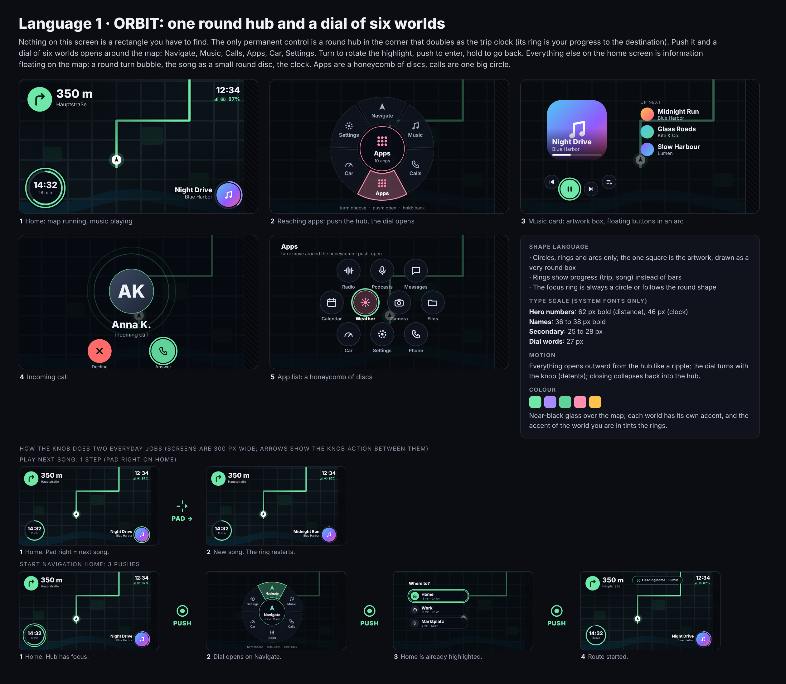
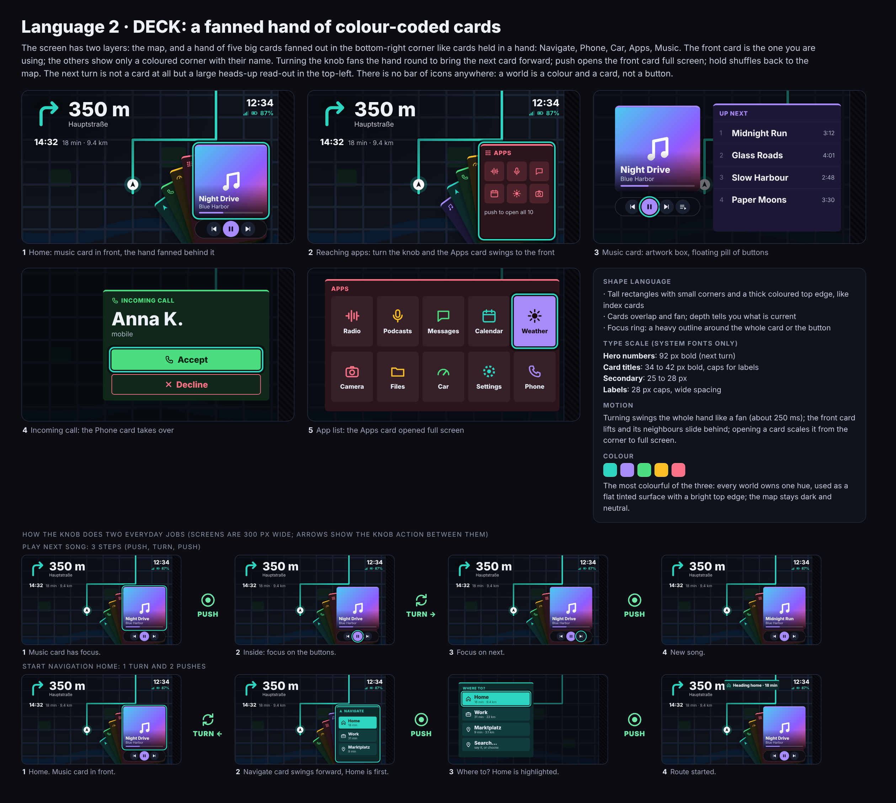
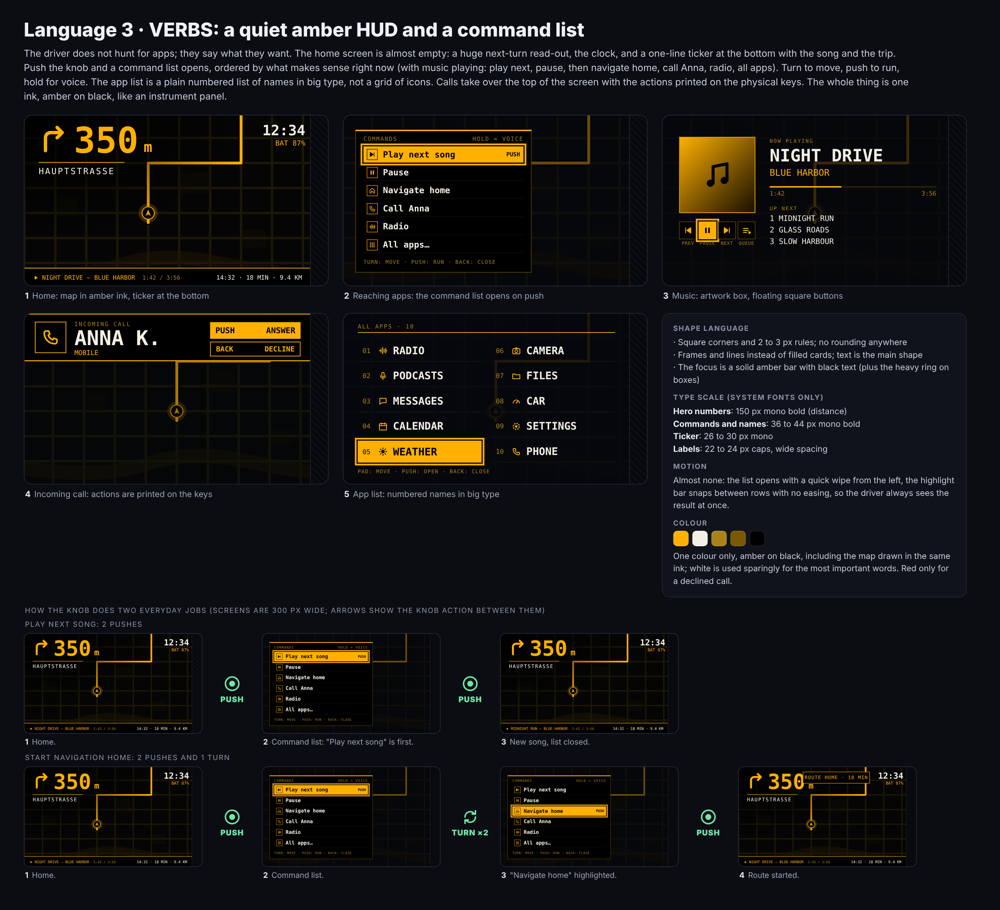
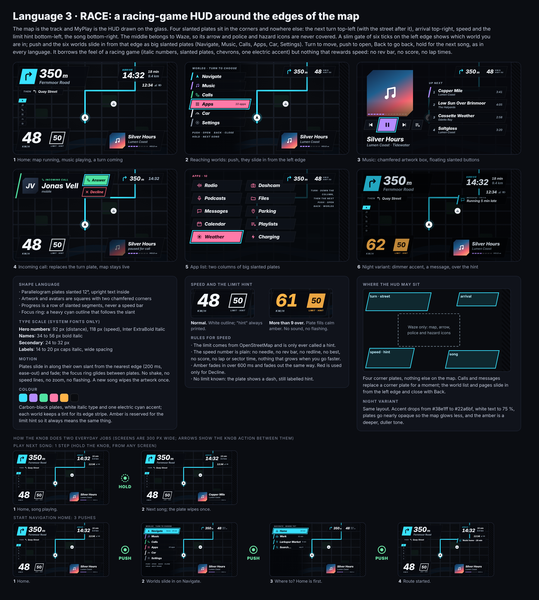

# New design languages for MyPlay's whole car screen

Brief from the owner: stop borrowing from Android Auto and CarPlay; invent something of our own. So none of these has a left rail of app icons, a bottom dock, or Google/Apple card shapes. All three are dark, built for the knob and pad only (turn, push, hold, pad up/down/left/right, Menu, Back), readable at a glance, with the map as the background and very few stops per action. The drawing is for a 1200 x 720 visible area (the hatched strip on the right is the unused part).

Everything is original: shapes, symbols and the invented street map are drawn for these pictures, text is the phone's system font (monospace for Verbs; RACE uses the free Inter font in italic), and the app names are generic. Each sheet has the home screen (map running, music playing), how apps are reached, the music card (artwork box with its own floating buttons), a call, the app list, the shape, type, motion and colour rules, and a strip of the knob path for two everyday jobs.

| | 1 Orbit | 2 Deck | 3 Race | 3 Verbs (earlier) |
|---|---|---|---|---|
| Idea | one round hub and a dial of six worlds | a fanned hand of colour cards | a racing-game HUD in the four corners | a quiet amber HUD and a command list |
| Reaching apps | push the hub, turn the dial | turn the knob to swing the Apps card forward | push, worlds slide in from the left edge, turn to Apps | push, then choose a command |
| Play next song | 1 step (pad right) | 3 steps (push, turn, push) | 1 step (hold the knob) | 2 pushes |
| Start navigation home | 3 pushes | 1 turn + 2 pushes | 3 pushes | 2 pushes + 1 turn (2 clicks) |
| Mood | round, calm, glassy | colourful, tactile, physical | fast-looking, sharp, one electric accent | technical, instrument-panel |
| Cost | needs a good radial animation | most drawing work; cards need depth | slanted plates are easy; italic type needs testing for glare | easiest to build; least pretty at first glance |

File names: RACE is the third language of this set and its files are `3-race.png` and `3-race-home.png`. The earlier third language, VERBS, keeps its own names (`3-verbs.png`, `3-verbs-home.png`) so the two never clash. Holding the knob means "next song" in every language.

The counts assume the pad can be used as a shortcut in Orbit (pad right = next song) and that a press on Home opens the main control in each language; if the car's controller has no pad, Orbit's next song becomes push, turn, push like Deck.

## 1. ORBIT: one round hub and a dial of six worlds

Home screen at full size: [1-orbit-home.png](1-orbit-home.png)

- **Idea:** the only permanent control is a round hub in the corner whose ring is your trip progress. Push it and a dial opens around the map with six worlds (Navigate, Music, Calls, Apps, Car, Settings); turn to choose, push to enter, hold to go back. Everything else is information floating on the map: a round turn bubble, the song as a small round disc.
- **Shape:** circles, rings and arcs only (the artwork is a very round box). **Type:** 62 px bold distance, 36 to 38 px names, 25 to 28 px secondary. **Motion:** ripples outward from the hub, the dial turns in detents. **Colour:** near-black glass, each world has its own accent.
- **Trade-off:** the friendliest and clearest for a knob, with the fewest stops. Honeycomb and dial need space for the round shapes and the home screen carries little information beyond turn, trip and song.

## 2. DECK: a fanned hand of colour-coded cards

Home screen at full size: [2-deck-home.png](2-deck-home.png)

- **Idea:** a hand of five cards fanned in the bottom-right corner (Navigate, Phone, Car, Apps, Music). The front card is the one in use; the others show a coloured corner. Turning the knob swings the hand round, push opens the front card, hold goes back to the map. The next turn is a large heads-up read-out, not a card.
- **Shape:** tall index-card rectangles with a thick coloured edge. **Type:** 92 px next turn, 34 to 42 px titles, caps labels. **Motion:** the whole hand swings like a fan. **Colour:** the most colourful, one flat hue per world.
- **Trade-off:** the most physical and memorable, and the world you are in is always obvious by colour. It takes the bottom-right of the map all the time and needs the most animation.

## 3. VERBS: a quiet amber HUD and a command list

Home screen at full size: [3-verbs-home.png](3-verbs-home.png)

- **Idea:** you do not hunt for apps; you pick a verb. Home is almost empty (huge next turn, clock, one ticker line). Push opens a command list ordered by what makes sense now (play next, pause, navigate home, call Anna, radio, all apps). Calls show actions printed on the keys. The app list is a numbered list of big names.
- **Shape:** square corners and thin rules. **Type:** 150 px mono distance, 36 to 44 px mono commands. **Motion:** almost none; the highlight bar snaps. **Colour:** amber on black, map drawn in the same ink.
- **Trade-off:** the fewest steps for the things you do most and the easiest to build, but it is the least visual, and the order of commands has to be predicted well or it is just a menu.

## 3. RACE: a racing-game HUD around the edges of the map

Home screen at full size: [3-race-home.png](3-race-home.png)

- **Idea:** the Waze map is the track and MyPlay is the HUD painted on the glass. Four slanted plates sit in the corners and nowhere else: the next turn and the street after it (top-left), arrival time (top-right), speed with the limit hint (bottom-left) and the song (bottom-right). The middle belongs to Waze, so its arrow and its police and hazard icons are never covered, and there is no minimap. A slim gate of six ticks on the left edge shows which world you are in; push and the six worlds (Navigate, Music, Calls, Apps, Car, Settings) slide in from that edge as big slanted plates while the map stays live on the right. Turn moves the ring, push opens, Back goes back, hold plays the next song. An incoming call takes the turn plate's place for a moment (the turn shrinks to a tab top-right); a message drops in under the arrival plate.
- **Shape:** parallelogram plates slanted 12° with upright text, artwork and avatars as squares with two chamfered corners, progress as a row of slanted segments, a heavy cyan ring that follows the slant. **Type:** Inter (free, OFL) ExtraBold Italic: 118 px speed, 92 px distance, 34 to 56 px names, 24 to 32 px secondary, 14 to 20 px caps labels. **Motion:** plates slide in along their own slant from the nearest edge (200 ms, ease-out) and fade; the ring glides between plates; a new song wipes the artwork once; no shake, speed lines, zoom or flashing. **Colour:** carbon-black plates, white type, one electric cyan accent (#38e1ff); each world keeps a tint for its edge stripe; amber (#ffb347) is reserved for the limit hint. The night variant keeps the layout but drops the accent to #22a6bf, the white to about 75 %, makes the plates nearly opaque and uses a duller amber.
- **Safety:** the speed is a plain number: no needle, rev bar, redline, best, score, lap or sector time. The limit comes from OpenStreetMap and is always labelled "hint"; when you are more than 9 km/h over, its plate fades to calm amber (600 ms, no sound, no flashing) and fades back when you slow down. With no limit known the plate shows a dash.
- **Trade-off:** the most energetic look of the set and the clearest map, since all four plates are pinned to the corners. Slanted italic type is a little harder to read than upright type in glare, so sizes are kept large; the world list covers the left third of the map while it is open, and the look may feel too sporty for some drivers (the night variant calms it down).

## Notes

- Which to pick can be mixed: Orbit's dial with Verbs' predicted order, or Deck's colours on Orbit's shapes. Say which parts to keep.
- These pictures do not change MyPlay or what the earlier layouts (A to F) do; they are an alternative to them.
- I worked from the written brief and did not read the MyPlay repository, so the app names, the song and the destinations are invented examples.
- To redraw: `node render.js` in this folder (needs Node and Playwright), or `node render.js race` for one language; sources are in `src/` (RACE is in `src/race.js`).
- The place names (Fernmoor Road, Quay Street, Larkspur Market), the songs and artists (Silver Hours by Lumen Coast, and the rest) and the callers are invented. The grey warning disc on the map stands in for whatever Waze draws there; MyPlay never redraws it.
